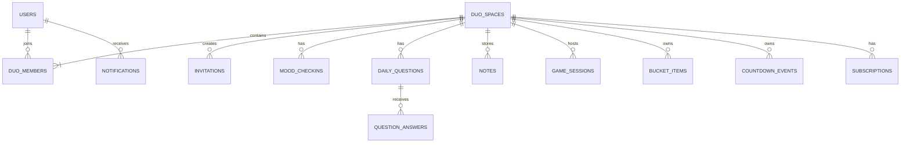

# DUO
## Product Requirements Document & Technical Blueprint

**Version:** 1.0  
**Product:** Duo  
**Audience:** Romantic couples  
**Brand personality:** Playful, warm, modern  
**Platforms:** Android and iOS  
**Framework:** Flutter  
**Business model:** Freemium, advertising, subscriptions and in-app purchases

---

# 1. Executive Summary

Duo is a private shared mobile experience designed for two people in a romantic relationship.

It combines daily connection activities, quizzes, private notes, multiplayer mini-games and shared planning into one application.

Instead of installing several different apps, a couple can use Duo to:

- Learn more about each other.
- Share daily moments.
- Send private messages and surprises.
- Play small games together.
- Plan activities and future goals.
- Build a shared collection of memories.

Duo is not intended to replace WhatsApp or other messaging applications. Its purpose is to make spending time and building memories together more enjoyable.

### Product positioning

**Duo — Two people. One little world.**

### Core principles

1. Private by default.
2. Designed exclusively for two connected partners.
3. Simple, playful and emotionally engaging.
4. Useful even when the two people are not together physically.
5. Free to start, with optional premium experiences.

---

# 2. Target Audience

## Primary audience

Couples aged 18 and above, including:

- Dating couples.
- Long-distance couples.
- Newly married couples.
- Married couples.
- Couples looking for fun daily activities.

The initial launch market is Bangladesh, with English and Bangla localization planned.

## User personas

### Persona A — Long-distance couple

Needs:
- Feel connected despite physical distance.
- Share daily experiences.
- Play games remotely.
- Send surprises and scheduled notes.

### Persona B — Young dating couple

Needs:
- Fun questions and quizzes.
- Playful interactions.
- Shared memories.
- Relationship milestones.

### Persona C — Married couple

Needs:
- Shared planning.
- Important date reminders.
- Bucket lists.
- Shared goals and memories.

The product should work for all three without requiring different app versions.

---

# 3. Product Structure

Duo consists of five feature modules.

| Module | Purpose | MVP priority |
|---|---|---|
| DuoDay | Daily connection | P0 |
| TwoTruths | Questions and quizzes | P0 |
| SecretNote | Private notes | P0 |
| TogetherPlay | Multiplayer games | P1 |
| OurLittleWorld | Shared plans and goals | P1 |

P0 means essential for the first usable release. P1 means included in the MVP with limited functionality or completed immediately after the first beta.

## 3.1 DuoDay — Daily Connection

Purpose: Give couples a simple reason to interact every day.

MVP:
- Daily mood check-in.
- Question of the day.
- View partner's submitted mood.
- Submit a short daily moment.
- Shared activity timeline.
- Basic streak indicator.

Later:
- Photo memories.
- Daily activity recommendations.
- Weekly relationship recap.
- Personalized activity prompts.

## 3.2 TwoTruths — Know Each Other

Purpose: Help couples discover new things about each other.

MVP:
- Daily question.
- Submit an answer privately.
- Guess partner's answer.
- Reveal answers together.
- Basic score and history.
- Question categories.

Later:
- Compatibility quizzes.
- Custom question creation.
- Couple challenges.
- Weekly quiz reports.
- AI-generated questions.

## 3.3 SecretNote — Private Messages

Purpose: Make private surprises and meaningful messages part of the relationship.

MVP:
- Create a private text note.
- Send a note to the partner.
- Read and mark as opened.
- Basic note history.

Later:
- Scheduled messages.
- Voice notes.
- Photo attachments.
- Anniversary letters.
- Surprise message templates.

Important: Duo is not a full real-time messaging replacement. Keep the initial experience focused on notes and surprises.

## 3.4 TogetherPlay — Play Together

Purpose: Give couples lightweight activities they can play remotely.

MVP:
- Tic-tac-toe.
- Would You Rather.
- Truth or Dare.
- Basic turn-based game sessions.

Later:
- Word guessing.
- Emoji guessing.
- Drawing challenges.
- Additional multiplayer games.
- Game packs and premium challenges.

## 3.5 OurLittleWorld — Build Together

Purpose: Help couples plan and remember things they want to do together.

MVP:
- Shared bucket list.
- Add and complete items.
- Shared countdowns.
- Important dates.
- Basic milestones.

Later:
- Shared travel planning.
- Shared goals.
- Habit challenges.
- Savings goal tracking.
- Calendar integrations.

Duo will not process or hold actual savings deposits in this feature.

---

# 4. MVP Scope

The MVP should validate one central hypothesis:

**Will two people regularly use one private application to interact, play and build shared memories?**

## Included in the first release

### Account and pairing
- Email authentication.
- Google sign-in.
- Apple sign-in where required for the iOS experience.
- Basic profile.
- Create Duo space.
- Invitation code/link.
- Accept invitation.
- Exactly two active members per space.
- Disconnect/unpair flow.

### DuoDay
- Daily mood.
- Daily question.
- Shared activity feed.
- Daily interaction history.

### TwoTruths
- Question categories.
- Answer submission.
- Partner answer guessing.
- Reveal and score.

### SecretNote
- Text notes.
- Private note inbox.
- Read status.

### TogetherPlay
- Tic-tac-toe.
- Would You Rather.
- Truth or Dare.

### OurLittleWorld
- Bucket list.
- Countdown events.
- Important dates.

### Platform
- Android.
- iOS.
- Push notifications.
- Analytics.
- Crash reporting.
- Subscription foundation.
- AdMob integration.

## Explicitly excluded from MVP

- Video calling.
- Full chat application.
- Unlimited photo and video storage.
- AI relationship advice.
- Public profiles.
- Public discovery.
- Group support.
- Social feed.
- Calendar synchronization.
- Advanced AI-generated content.

Avoiding these features keeps the first release achievable.

---

# 5. Application Navigation

Use a five-item bottom navigation.

| Tab | Purpose |
|---|---|
| Home | Duo overview and daily activity |
| Play | Questions, quizzes and games |
| Memories | SecretNote and shared moments |
| Together | Bucket list, countdowns and goals |
| Profile | Account, pairing and settings |

## Home screen layout

Suggested order:

1. Duo greeting and partner profile.
2. Today's mood status.
3. Question of the day.
4. Daily interaction card.
5. Recent private notes.
6. Upcoming countdown.
7. Shared progress.
8. Quick actions.

The home screen should prioritize actions rather than becoming a dashboard full of statistics.

---

# 6. Screen-by-Screen UX and User Flows

## Flow A — First-time onboarding

### Screen 01: Splash
- Duo logo.
- Brand tagline.
- Loading state.

### Screen 02: Welcome
- Short product introduction.
- Create account.
- Sign in.

### Screen 03: Authentication
- Email.
- Google.
- Apple.
- Terms and privacy links.

### Screen 04: Profile setup
- Display name.
- Birthday (optional).
- Profile image (optional).
- Preferred language.

### Screen 05: Relationship setup
- Create a Duo space.
- Join an existing Duo space.

### Screen 06: Invite partner
- Generate invitation link.
- Generate invitation code.
- Share through device share sheet.
- Show pending invitation status.

### Screen 07: Pairing confirmation
- Display both profiles.
- Confirm connection.
- Create shared space.

### Screen 08: Home
- Welcome message.
- Explain the five features.
- Encourage first daily interaction.

## Flow B — Joining a Duo space

1. Open invitation link or enter invitation code.
2. Authenticate or create account.
3. Preview inviter's display name.
4. Accept invitation.
5. Confirm pairing.
6. Open the shared home screen.

Important: Joining must be atomic. Two people attempting to claim the same invitation simultaneously must not create duplicate memberships.

## Flow C — Daily mood check-in

1. Open Home.
2. Tap mood card.
3. Select mood.
4. Optionally add a short message.
5. Submit.
6. Show partner's mood when available.
7. Allow the partner to respond.

## Flow D — TwoTruths quiz

1. Open Play.
2. Select a question category.
3. Start today's question.
4. Submit your own answer.
5. Wait for partner answer.
6. Guess partner's answer.
7. Reveal both answers.
8. Show result and next question.

The game must support asynchronous participation. Both people should not need to be online at the same time.

## Flow E — SecretNote

1. Open Memories.
2. Tap New Note.
3. Enter note title and content.
4. Preview.
5. Send.
6. Partner receives notification.
7. Partner opens the note.
8. Sender sees opened status.

## Flow F — TogetherPlay

1. Open Play.
2. Select a game.
3. Create game session.
4. Notify partner.
5. Partner joins.
6. Players take turns.
7. Save result.
8. Offer another round.

## Flow G — OurLittleWorld

1. Open Together.
2. Select bucket list or countdown.
3. Add an item or event.
4. Save to shared space.
5. Partner receives notification.
6. Either partner can update completion status.

## Flow H — Premium purchase

1. Open Profile or a premium feature.
2. View Duo Premium benefits.
3. Select monthly or annual plan.
4. Complete platform billing.
5. Verify purchase with backend.
6. Activate shared Duo entitlement.
7. Both members receive premium access.

The backend must verify purchases. Do not trust client-side purchase success alone.

## Flow I — Unpairing

1. Open Profile.
2. Select Relationship Settings.
3. Select Disconnect Duo.
4. Show clear consequences.
5. Require confirmation.
6. Revoke access to shared content.
7. Preserve or delete records according to the user's choices and retention policy.
8. Allow future pairing under defined restrictions.

Unpairing must never silently expose shared content to another partner.

---

# 7. Functional Requirements

| ID | Requirement | Priority |
|---|---|---|
| FR-001 | User registration and login | P0 |
| FR-002 | Profile creation | P0 |
| FR-003 | Create Duo space | P0 |
| FR-004 | Invite partner | P0 |
| FR-005 | Accept invitation | P0 |
| FR-006 | Enforce maximum two members | P0 |
| FR-007 | Daily mood check-in | P0 |
| FR-008 | Daily questions | P0 |
| FR-009 | Guess partner answers | P0 |
| FR-010 | Private text notes | P0 |
| FR-011 | Shared bucket list | P1 |
| FR-012 | Countdown events | P1 |
| FR-013 | Tic-tac-toe | P1 |
| FR-014 | Would You Rather | P1 |
| FR-015 | Truth or Dare | P1 |
| FR-016 | Push notifications | P0 |
| FR-017 | Premium entitlement | P0 |
| FR-018 | AdMob integration | P1 |
| FR-019 | Account deletion | P0 |
| FR-020 | Unpairing and access revocation | P0 |

---

# 8. Non-Functional Requirements

## Security and privacy
- All network traffic uses HTTPS.
- Row-level authorization for every shared resource.
- No public access to private Duo spaces.
- Secure invitation tokens.
- Signed URLs for private media.
- Rate limiting on invitation and authentication endpoints.
- Server-side purchase validation.
- Account deletion and data export support.
- Avoid sensitive content in analytics events and notification previews.

## Performance
- Home screen should load quickly on typical mobile networks.
- Paginate activity and memory history.
- Compress uploaded images.
- Avoid downloading large media unnecessarily.
- Use realtime updates selectively.

## Reliability
- Handle offline and reconnect scenarios.
- Make write operations idempotent where practical.
- Prevent duplicate daily submissions.
- Preserve game state during temporary disconnects.
- Implement backup and recovery procedures.

## Accessibility
- Support text scaling.
- Use adequate contrast.
- Provide accessible labels.
- Avoid communicating game status through color alone.

---

# 9. Recommended Technology Stack

| Layer | Technology |
|---|---|
| Mobile | Flutter + Dart |
| State management | Riverpod |
| Routing | GoRouter |
| Models | Freezed + json_serializable |
| Backend | Supabase |
| Database | PostgreSQL |
| Authentication | Supabase Auth |
| Realtime | Supabase Realtime |
| Storage | Supabase Storage |
| Server functions | Supabase Edge Functions |
| Push notifications | Firebase Cloud Messaging |
| Ads | Google AdMob |
| Android payments | Google Play Billing |
| iOS payments | StoreKit through a Flutter billing package |
| Analytics | Firebase Analytics |
| Crash reporting | Firebase Crashlytics |
| CI/CD | GitHub Actions |

### Why Supabase?

Duo's data model is highly relational:

- Two users belong to one shared space.
- A space owns notes, questions, games and goals.
- Each user creates their own answers and activities.
- Premium entitlement belongs to the shared space.

PostgreSQL fits these relationships naturally.

Start with Supabase rather than building a custom NestJS backend immediately. Use Edge Functions for privileged operations. A dedicated NestJS service can be introduced if business logic or infrastructure requirements justify it.

---

# 10. Database Design

Use UUID primary keys, UTC timestamps and PostgreSQL foreign keys.

## 10.1 Entity relationship overview



## 10.2 Core tables

### users

| Column | Type | Description |
|---|---|---|
| id | UUID PK | Auth user ID |
| display_name | TEXT | Display name |
| avatar_path | TEXT nullable | Private avatar path |
| language | TEXT | en / bn |
| timezone | TEXT | User timezone |
| created_at | TIMESTAMPTZ | Creation time |
| updated_at | TIMESTAMPTZ | Last update |

### duo_spaces

| Column | Type | Description |
|---|---|---|
| id | UUID PK | Shared space ID |
| name | TEXT | Optional shared name |
| status | TEXT | pending / active / disconnected |
| created_by | UUID FK | Creator |
| created_at | TIMESTAMPTZ | Creation time |
| disconnected_at | TIMESTAMPTZ nullable | Disconnection time |

### duo_members

| Column | Type | Description |
|---|---|---|
| id | UUID PK | Membership ID |
| duo_id | UUID FK | Shared space |
| user_id | UUID FK | User |
| role | TEXT | owner / member |
| joined_at | TIMESTAMPTZ | Join time |
| status | TEXT | active / removed |

Constraints:
- Unique active membership per user if the product enforces one active Duo per user.
- Maximum two active members per Duo.
- A user cannot be a member twice in the same space.

The two-member maximum requires a transactional database function or trigger. A simple application-side check is insufficient under concurrent requests.

### duo_invitations

| Column | Type | Description |
|---|---|---|
| id | UUID PK | Invitation ID |
| duo_id | UUID FK | Target Duo |
| token_hash | TEXT | Hashed invitation token |
| created_by | UUID FK | Inviter |
| expires_at | TIMESTAMPTZ | Expiry |
| accepted_by | UUID nullable | Accepted user |
| accepted_at | TIMESTAMPTZ nullable | Acceptance time |
| status | TEXT | pending / accepted / expired / revoked |

Never store raw invitation secrets in the database.

### mood_checkins

| Column | Type | Description |
|---|---|---|
| id | UUID PK | Check-in |
| duo_id | UUID FK | Shared space |
| user_id | UUID FK | Author |
| mood | TEXT | Selected mood |
| message | TEXT nullable | Optional text |
| local_date | DATE | User's local date |
| created_at | TIMESTAMPTZ | Submission time |

Unique constraint: one check-in per user, Duo and local date, unless multiple check-ins are deliberately supported.

### daily_questions

| Column | Type | Description |
|---|---|---|
| id | UUID PK | Question |
| text_en | TEXT | English |
| text_bn | TEXT | Bangla |
| category | TEXT | Category |
| active | BOOLEAN | Available |
| created_at | TIMESTAMPTZ | Creation time |

### question_sessions

| Column | Type | Description |
|---|---|---|
| id | UUID PK | Session |
| duo_id | UUID FK | Shared space |
| question_id | UUID FK | Question |
| session_date | DATE | Local session date |
| status | TEXT | open / completed |
| created_at | TIMESTAMPTZ | Creation time |

### question_answers

| Column | Type | Description |
|---|---|---|
| id | UUID PK | Answer |
| session_id | UUID FK | Session |
| user_id | UUID FK | Author |
| answer | TEXT | Answer |
| guessed_answer | TEXT nullable | Guess |
| created_at | TIMESTAMPTZ | Submission |

Unique constraint: one answer per user per session.

### notes

| Column | Type | Description |
|---|---|---|
| id | UUID PK | Note |
| duo_id | UUID FK | Shared space |
| sender_id | UUID FK | Sender |
| title | TEXT | Note title |
| body | TEXT | Note body |
| opened_at | TIMESTAMPTZ nullable | Read time |
| created_at | TIMESTAMPTZ | Creation |

### game_sessions

| Column | Type | Description |
|---|---|---|
| id | UUID PK | Game |
| duo_id | UUID FK | Shared space |
| game_type | TEXT | tic_tac_toe, truth_dare, etc. |
| state | JSONB | Validated game state |
| current_turn | UUID nullable | Active player |
| status | TEXT | waiting / active / completed |
| winner_id | UUID nullable | Winner |
| created_at | TIMESTAMPTZ | Creation |

Game state must be validated server-side. Never trust a client to declare its own win.

### bucket_items

| Column | Type | Description |
|---|---|---|
| id | UUID PK | Item |
| duo_id | UUID FK | Shared space |
| title | TEXT | Item title |
| description | TEXT nullable | Details |
| created_by | UUID FK | Creator |
| is_completed | BOOLEAN | Completion |
| completed_at | TIMESTAMPTZ nullable | Completion time |
| created_at | TIMESTAMPTZ | Creation |

### countdown_events

| Column | Type | Description |
|---|---|---|
| id | UUID PK | Event |
| duo_id | UUID FK | Shared space |
| title | TEXT | Event title |
| event_date | DATE | Date |
| created_by | UUID FK | Creator |
| created_at | TIMESTAMPTZ | Creation |

### subscriptions

| Column | Type | Description |
|---|---|---|
| id | UUID PK | Subscription record |
| duo_id | UUID FK | Shared space |
| product_id | TEXT | Store product |
| platform | TEXT | google / apple |
| purchase_token_ref | TEXT | Secure purchase reference |
| status | TEXT | active / expired / revoked |
| expires_at | TIMESTAMPTZ nullable | Expiration |
| updated_at | TIMESTAMPTZ | Last validation |

Keep actual purchase tokens encrypted or in a protected server-side store, not in client-readable tables.

### notifications

| Column | Type | Description |
|---|---|---|
| id | UUID PK | Notification |
| user_id | UUID FK | Recipient |
| duo_id | UUID FK | Shared space |
| type | TEXT | Notification type |
| payload | JSONB | Minimal metadata |
| read_at | TIMESTAMPTZ nullable | Read time |
| created_at | TIMESTAMPTZ | Creation |

## 10.3 Additional tables for later

- `media_assets`
- `shared_goals`
- `goal_updates`
- `milestones`
- `user_devices`
- `purchase_events`
- `audit_events`
- `notification_preferences`
- `content_reports`

## 10.4 Database Security & Atomic RPC Functions

Every private table has PostgreSQL Row Level Security (RLS) enabled. A user is authorized to read, insert, or update data if and only if they are an active member of the corresponding Duo space.

### 10.4.1 Reusable RLS Helper Function

To avoid repetitive subqueries and infinite recursion in RLS policies, define a cached, security-definer helper:

```sql
CREATE OR REPLACE FUNCTION is_duo_member(target_duo_id UUID)
RETURNS BOOLEAN LANGUAGE sql SECURITY DEFINER STABLE AS $$
  SELECT EXISTS (
    SELECT 1 FROM duo_members
    WHERE duo_id = target_duo_id
      AND user_id = auth.uid()
      AND status = 'active'
  );
$$;
```

Sample RLS Policy on `notes`:
```sql
ALTER TABLE notes ENABLE ROW LEVEL SECURITY;

CREATE POLICY "Duo members can read notes in their space"
  ON notes FOR SELECT
  USING (is_duo_member(duo_id));

CREATE POLICY "Duo members can insert notes into their space"
  ON notes FOR INSERT
  WITH CHECK (is_duo_member(duo_id) AND sender_id = auth.uid());
```

### 10.4.2 Atomic Pairing & Concurrency Control (PostgreSQL RPC)

Pairing must prevent race conditions (e.g. two people claiming an invite code at the exact same millisecond). PostgreSQL transaction locks (`FOR UPDATE`) guarantee atomic execution:

```sql
-- Accept invitation atomically
CREATE OR REPLACE FUNCTION accept_invitation(p_invite_code TEXT)
RETURNS JSONB LANGUAGE plpgsql SECURITY DEFINER AS $$
DECLARE
  v_invite RECORD;
  v_member_count INT;
  v_user_id UUID := auth.uid();
BEGIN
  IF v_user_id IS NULL THEN
    RAISE EXCEPTION 'UNAUTHORIZED';
  END IF;

  -- 1. Check if user is already actively paired
  IF EXISTS (SELECT 1 FROM duo_members WHERE user_id = v_user_id AND status = 'active') THEN
    RETURN jsonb_build_object('success', false, 'error', 'ALREADY_PAIRED');
  END IF;

  -- 2. Lock invitation row
  SELECT * INTO v_invite
  FROM duo_invitations
  WHERE token_hash = encode(sha256(p_invite_code::bytea), 'hex')
    AND status = 'pending'
    AND expires_at > now()
  FOR UPDATE;

  IF NOT FOUND THEN
    RETURN jsonb_build_object('success', false, 'error', 'INVALID_OR_EXPIRED_INVITE');
  END IF;

  -- 3. Lock duo space and verify active member count < 2
  PERFORM 1 FROM duo_spaces WHERE id = v_invite.duo_id FOR UPDATE;

  SELECT count(*) INTO v_member_count
  FROM duo_members
  WHERE duo_id = v_invite.duo_id AND status = 'active';

  IF v_member_count >= 2 THEN
    RETURN jsonb_build_object('success', false, 'error', 'DUO_FULL');
  END IF;

  -- 4. Add member
  INSERT INTO duo_members (duo_id, user_id, role, status)
  VALUES (v_invite.duo_id, v_user_id, 'member', 'active');

  -- 5. Mark invitation accepted
  UPDATE duo_invitations
  SET status = 'accepted', accepted_by = v_user_id, accepted_at = now()
  WHERE id = v_invite.id;

  -- 6. Mark duo_space active
  UPDATE duo_spaces
  SET status = 'active'
  WHERE id = v_invite.duo_id;

  RETURN jsonb_build_object('success', true, 'duo_id', v_invite.duo_id);
END;
$$;
```

### 10.4.3 Supabase Realtime Publication

To enable real-time updates between partners without excessive polling, add the following tables to the Supabase Realtime publication:

```sql
ALTER PUBLICATION supabase_realtime ADD TABLE mood_checkins;
ALTER PUBLICATION supabase_realtime ADD TABLE question_answers;
ALTER PUBLICATION supabase_realtime ADD TABLE notes;
ALTER PUBLICATION supabase_realtime ADD TABLE game_sessions;
ALTER PUBLICATION supabase_realtime ADD TABLE bucket_items;
ALTER PUBLICATION supabase_realtime ADD TABLE duo_spaces;
```

---

# 11. API Design & Mini-Game State Specifications

Communication uses Supabase PostgREST for standard queries and PostgreSQL RPC / Edge Functions for sensitive operations.

Base Endpoint: `https://<project-ref>.supabase.co`

## 11.1 API Surface

### Duo Pairing & Space Management
| Type | Name | Purpose | Error Codes |
|---|---|---|---|
| RPC | `create_duo_space(p_name TEXT)` | Create space & assign owner | `ALREADY_PAIRED` |
| RPC | `create_invitation(p_duo_id UUID, p_hours INT)` | Returns 8-char code & hash | `UNAUTHORIZED`, `DUO_FULL` |
| RPC | `accept_invitation(p_invite_code TEXT)` | Atomic claim & join | `INVALID_OR_EXPIRED_INVITE`, `DUO_FULL`, `ALREADY_PAIRED` |
| RPC | `disconnect_duo(p_duo_id UUID)` | Revoke shared access | `UNAUTHORIZED`, `NOT_FOUND` |

### DuoDay & TwoTruths
| Type | Name | Purpose |
|---|---|---|
| REST | `GET /rest/v1/mood_checkins` | Fetch current/past mood logs |
| REST | `POST /rest/v1/mood_checkins` | Upsert today's mood (unique on user, duo, date) |
| REST | `GET /rest/v1/question_sessions` | Retrieve current daily question session |
| RPC | `submit_question_answer(p_session_id UUID, p_answer TEXT)` | Submit personal answer privately |
| RPC | `submit_partner_guess(p_session_id UUID, p_guess TEXT)` | Submit guess for partner's answer |
| REST | `GET /rest/v1/notes` | Fetch received/sent letters |
| RPC | `mark_note_opened(p_note_id UUID)` | Updates `opened_at` timestamp |

### 11.2 TogetherPlay: Mini-Game JSONB State Schemas

All multiplayer game logic is validated server-side. The `game_sessions.state` column stores structured JSONB objects:

#### 1. Tic-Tac-Toe State
```json
{
  "board": [null, "X", null, null, "O", null, null, null, null],
  "player_x": "uuid-partner-1",
  "player_o": "uuid-partner-2",
  "current_turn": "uuid-partner-1",
  "moves_count": 2,
  "winner": null,
  "is_draw": false,
  "last_move_at": "2026-10-30T07:15:00Z"
}
```

#### 2. Would You Rather State
```json
{
  "card_id": "wyr_105",
  "prompt": "Would you rather have a surprise weekend getaway or a quiet candlelit dinner at home?",
  "option_a": "Surprise weekend getaway",
  "option_b": "Quiet candlelit dinner at home",
  "answers": {
    "uuid-partner-1": "A",
    "uuid-partner-2": "A"
  },
  "is_revealed": true,
  "is_match": true
}
```

#### 3. Truth or Dare State
```json
{
  "active_player": "uuid-partner-1",
  "category": "romantic",
  "type": "truth",
  "prompt_text": "What was the exact moment you realized you had feelings for me?",
  "status": "pending_response",
  "completed_at": null
}
```

## 11.3 TwoTruths Asynchronous Reveal Flow

```text
[Partner A submits answer] ───> Recorded in question_answers (Partner B cannot see text)
                                                      │
[Partner B submits answer] ───> Both answers submitted: System unlocks guessing phase
                                                      │
[Partner A guesses B's answer] ─┐
[Partner B guesses A's answer] ─┴─> RPC calculates match score & reveals both cards!
```

---

# 12. Flutter Architecture

Use a feature-first architecture with clear separation between presentation, application logic and data access.

## Suggested project structure

```text
duo/
├── android/
├── ios/
├── assets/
│   ├── images/
│   ├── icons/
│   ├── animations/
│   └── fonts/
│
├── lib/
│   ├── main.dart
│   ├── app.dart
│   │
│   ├── core/
│   │   ├── config/
│   │   ├── constants/
│   │   ├── errors/
│   │   ├── routing/
│   │   ├── theme/
│   │   ├── utils/
│   │   └── widgets/
│   │
│   ├── shared/
│   │   ├── models/
│   │   ├── providers/
│   │   ├── services/
│   │   └── repositories/
│   │
│   ├── features/
│   │   ├── auth/
│   │   │   ├── data/
│   │   │   ├── domain/
│   │   │   └── presentation/
│   │   │
│   │   ├── pairing/
│   │   ├── home/
│   │   ├── duoday/
│   │   ├── twotruths/
│   │   ├── secretnote/
│   │   ├── togetherplay/
│   │   ├── ourlittleworld/
│   │   ├── notifications/
│   │   ├── premium/
│   │   └── profile/
│   │
│   └── l10n/
│
├── test/
└── integration_test/
```

Each feature should follow a consistent structure:

```text
feature/
├── data/
│   ├── datasources/
│   ├── models/
│   └── repositories/
├── domain/
│   ├── entities/
│   ├── repositories/
│   └── usecases/
└── presentation/
    ├── controllers/
    ├── providers/
    ├── screens/
    └── widgets/
```

## Recommended Flutter packages

| Package | Purpose |
|---|---|
| `flutter_riverpod` | State management |
| `go_router` | Navigation |
| `supabase_flutter` | Backend integration |
| `freezed` | Immutable models |
| `json_serializable` | JSON serialization |
| `hive_flutter` | Fast offline key-value & JSON document cache |
| `cached_network_image` | Image caching |
| `flutter_local_notifications` | Local notifications |
| `firebase_messaging` | Push notifications |
| `google_mobile_ads` | AdMob |
| `in_app_purchase` | Store billing |
| `share_plus` | Invitation sharing |
| `intl` | Date and localization |
| `connectivity_plus` | Connectivity awareness |

Pin compatible package versions and review platform requirements during implementation.

## State Management & Realtime Channels

Use Riverpod providers with selective rebuilds:
- Authentication state (`authStateProvider`).
- Current user & profile (`currentUserProvider`).
- Current Duo space & membership (`duoSpaceProvider`).
- Partner profile & status (`partnerProfileProvider`).
- Daily question & answer state (`dailyQuestionNotifierProvider`).
- Mood state & today's check-ins (`moodNotifierProvider`).
- Secret notes list & composer (`notesNotifierProvider`).
- Active game session & turns (`gameSessionNotifierProvider`).
- Premium entitlement status (`premiumSubscriptionProvider`).

### Realtime Subscription Architecture
Instead of listening globally, each feature controller binds to a scoped Supabase channel filtered by the active `duo_id`:

```dart
final duoChannel = supabase.channel('duo:${currentDuo.id}')
  .onPostgresChanges(
    event: PostgresChangeEvent.all,
    schema: 'public',
    table: 'mood_checkins',
    filter: PostgresChangeFilter(
      type: PostgresChangeFilterType.eq,
      column: 'duo_id',
      value: currentDuo.id,
    ),
    callback: (payload) => ref.read(moodNotifierProvider.notifier).handleRemoteChange(payload),
  )
  .subscribe();
```

## Offline-First Caching Strategy

Due to intermittent mobile connectivity in target markets, Duo applies an **optimistic-first offline cache**:
1. **Local Store (Hive):**
   - Active user & partner profile.
   - Current daily question and local answer draft.
   - Last 30 received/sent secret notes (encrypted box).
   - Shared bucket list and countdown dates.
2. **Optimistic UI:**
   - Mood selection and bucket check-offs render immediately in the UI.
   - Write actions queue into a local offline sync queue.
   - Upon network restoration (detected via `connectivity_plus`), the queue synchronizes changes upstream idempotently.

## Navigation

Use GoRouter with authentication-aware redirects.

Suggested routes:

```text
/splash
/welcome
/auth
/profile/setup
/pairing
/pairing/invite
/pairing/join
/home
/play
/play/twotruths
/play/games
/memories
/memories/new-note
/together
/together/bucket-list
/together/countdowns
/profile
/profile/premium
/profile/settings
```

---

# 13. UI/UX Design Direction

## Brand personality

Playful, warm, modern and intimate.

Avoid making the entire product overly romantic. It should feel suitable for young couples as well as married couples.

## Visual direction

- Soft rounded cards.
- Friendly typography.
- Subtle animations.
- Warm gradients used sparingly.
- Playful illustrations.
- Clear icons.
- Light and dark themes.
- Bangla and English localization.

## Suggested colors

| Token | Suggested color |
|---|---|
| Primary | Coral pink `#FF6B81` |
| Secondary | Lavender `#9B8AFB` |
| Accent | Warm yellow `#FFC857` |
| Background | `#FFF8F7` |
| Dark background | `#191821` |
| Text | `#292633` |

These are initial design tokens, not final branding.

## UX principles

- Most daily interactions should take less than 30 seconds.
- Avoid unnecessary onboarding screens.
- Keep the partner's activity visible without exposing private content in public notifications.
- Provide clear loading, empty and error states.
- Make shared actions understandable to both partners.

---

# 14. Monetization Strategy

Duo should be free to use, with premium features that enhance the shared experience.

## Free tier

- One connected partner.
- Basic DuoDay.
- Basic TwoTruths questions.
- Basic SecretNote.
- Selected mini-games.
- Limited shared memories.
- Basic bucket list and countdowns.
- Non-intrusive advertisements.

## Duo Premium

Initial pricing hypotheses for Bangladesh:

| Plan | Proposed price | Equivalent / Savings |
|---|---:|---|
| Monthly | ৳99 / month | Standard flexible tier |
| Annual | ৳799 / year | ~৳66 / month (33% discount) |
| Lifetime | ৳1,799 one-time | Single purchase for long-term couples |

These prices require testing against platform store fees (15% Google/Apple small business tier), VAT, and infrastructure operating costs.

Premium features:
- Ad-free experience throughout the application.
- High-resolution photo memory storage.
- Premium question packs (*Spicy*, *Deep Compatibility*, *Future Planning*).
- Additional couple games (Word guessing, Emoji challenge).
- Exclusive stationery and themes for SecretNote.
- Scheduled surprise letters.
- Shared home screen customizations.

## Shared Entitlement & Lifecycle Policies

Duo Premium operates on a **couple-first shared entitlement** model: one partner's subscription or lifetime purchase unlocks Duo Premium for both members of the active Duo space.

### Lifecycle Scenarios & Rules:
1. **Subscription Expiry / Payment Failure:**
   - 16-day grace period during billing retry.
   - If billing fails completely, Duo space reverts to Free tier.
   - Existing memories, notes, and photos remain accessible in read-only mode; none are deleted.
2. **Purchaser Unpairs / Disconnects:**
   - Entitlement remains bound to the paying user's platform account.
   - If the paying user creates or joins a new Duo space, Premium status transfers to the new space.
   - The former partner reverts to the Free tier unless they purchase their own subscription.
3. **Purchase Restoration:**
   - The user triggers `"Restore Purchases"` in Profile.
   - The mobile client queries StoreKit / Google Play Billing for verified receipts.
   - Receipts are submitted to `/functions/v1/purchase-restore` for server-side verification before updating the `subscriptions` table.

## Advertising strategy

Use AdMob for native and banner placements where appropriate.

Recommended locations:
- Selected game screens.
- Non-intrusive content discovery areas.
- Optional rewarded ads for cosmetic rewards.

Avoid:
- Ads inside private notes.
- Ads between intimate interactions.
- Interstitials after every game move.
- Ads that interrupt onboarding or pairing.

Do not use sensitive relationship information for ad targeting.

---

# 15. Security, Privacy and Abuse Prevention

Duo handles personal and potentially sensitive relationship content. Privacy must be part of the architecture from day one.

Requirements:

1. Enforce two-member maximum at database level.
2. Verify Duo membership for every shared-resource operation.
3. Use short-lived invitation tokens.
4. Support invitation revocation.
5. Revoke access immediately after unpairing.
6. Allow account and content deletion.
7. Provide a clear privacy policy.
8. Do not reveal private note contents in push notifications by default.
9. Limit media upload size and type.
10. Rate-limit invitations and repeated requests.
11. Prevent one partner from silently accessing another account.
12. Provide block/report mechanisms for abuse.
13. Use secure account recovery.
14. Keep audit records for security-sensitive operations without collecting private message content.

Do not claim end-to-end encryption unless the entire content and key-management architecture genuinely supports it.

For the first release, use encrypted transport, secure server-side access control, private storage and strict database policies.

---

# 16. Analytics and Product Metrics

Measure pairs, not just individual users.

## Acquisition
- App installs.
- Account creation.
- Invitation creation.
- Invitation acceptance.

## Activation
- Percentage of users who successfully pair.
- Percentage of pairs completing their first interaction.
- Time from installation to successful pairing.

## Engagement
- Daily active pairs.
- Weekly active pairs.
- Daily interactions per pair.
- Questions completed.
- Notes sent and opened.
- Games played.
- Bucket-list activity.

## Retention
- D1 retention.
- D7 retention.
- D30 retention.
- Active pairs after invitation acceptance.

## Revenue
- Premium conversion.
- Monthly recurring revenue.
- Revenue per active pair.
- Subscription renewal.
- Ad revenue per active user.

Do not optimize for raw screen views. The key metric is **weekly active pairs**.

---

# 17. Testing Strategy

## Unit tests
- Pairing validation.
- Invitation expiry.
- Daily question logic.
- Quiz scoring.
- Game state validation.
- Subscription entitlement.

## Integration tests
- Account registration.
- Create Duo.
- Invite and accept.
- Shared content visibility.
- Partner notification.
- Purchase verification.
- Unpair and access revocation.

## Security tests
- User A cannot access unrelated Duo B.
- Third user cannot join an occupied Duo.
- Expired invitation cannot be used.
- Removed member cannot access old shared content.
- Client cannot grant itself premium.
- Client cannot manipulate game outcomes.

## Device tests
- Low-end Android devices.
- Different Android screen sizes.
- iPhones.
- Slow and unstable networks.
- App background and foreground transitions.
- Notification permissions denied.

---

# 18. Development Roadmap

Assuming one focused developer or a small team, the following is a practical initial roadmap.

| Phase | Duration | Deliverable |
|---|---:|---|
| Product design | 1–2 weeks | PRD, wireframes, design system |
| Core foundation | 2 weeks | Authentication, pairing, shared home |
| DuoDay + TwoTruths | 2–3 weeks | Daily engagement |
| SecretNote | 1–2 weeks | Private notes |
| TogetherPlay | 1–2 weeks | Basic multiplayer games |
| OurLittleWorld | 1 week | Bucket lists and countdowns |
| Billing and ads | 1–2 weeks | Monetization |
| Testing and beta | 2 weeks | Release candidate |

**Estimated total: 12–16 weeks.**

This is a planning estimate, not a delivery guarantee. Store approvals, security testing, design iteration and backend complexity can extend the schedule.

---

# 19. MVP Release Criteria

Do not release publicly until:

- Two accounts can connect successfully.
- No Duo space can have more than two active members.
- Shared content is properly isolated.
- Pairing and unpairing work reliably.
- Daily questions and answers work.
- Notes can be sent and opened.
- Basic games work between two devices.
- Bucket lists and countdowns synchronize.
- Push notifications work on supported devices.
- Purchase validation is server-side.
- Account deletion works.
- Crash reporting and analytics are enabled.
- Privacy policy and terms are published.
- Core flows have been tested on Android and iOS.

## Beta target

Recruit 30–50 couples for the first closed beta.

Observe:
- Whether both partners complete onboarding.
- Whether they return after seven days.
- Which modules they use.
- Whether they invite other couples.
- Whether anyone is willing to pay for premium.

Do not expand the feature set until the beta shows which experiences create genuine repeat usage.

---

# 20. Immediate Development Backlog

The first engineering sprint should focus on the foundation.

| Task | Priority |
|---|---|
| Create Flutter repository | Critical |
| Configure Android and iOS builds | Critical |
| Set up Supabase project | Critical |
| Create initial database migrations | Critical |
| Configure authentication | Critical |
| Build profile setup | High |
| Build Duo space creation | Critical |
| Build invitation generation | Critical |
| Build invitation acceptance | Critical |
| Enforce two-member membership constraint | Critical |
| Add RLS policies | Critical |
| Build pairing screens | Critical |
| Build shared Home screen | High |
| Add CI pipeline | High |
| Add crash reporting | High |

## Final recommendation

Build Duo as a modular Flutter application backed by Supabase.

Do not start with all five feature modules simultaneously. First build the secure pairing system and shared data foundation. Every subsequent module will depend on that foundation.

The first meaningful milestone is simple:

**Two people install Duo, connect successfully, answer a daily question and see each other's answers.**

If that experience is enjoyable and they return, Duo has a foundation worth expanding.